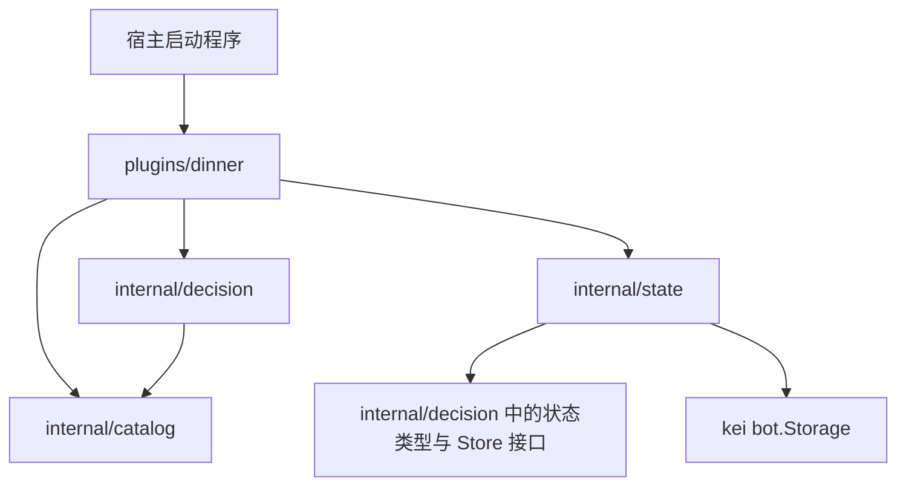

# 晚饭决策插件最小系统设计

> **历史设计。** 2026-10-10 起由会话列表与投票方案取代；当前命令和行为以 [usage.md](usage.md) 为准。本文保留最初的个人决策设计，不再描述群投票、`/dinner 25` 等现行命令。

本文描述历史设计与验收标准，不代表当前实现状态。

## 1. 目标与最小范围

为 kei 提供一个独立 Go 插件：用户发送命令后，从维护好的候选清单中得到今晚的用餐选择；可以换一个、标记已吃，并根据近期实际用餐记录降低重复选择的概率。

采用以下默认范围，使第一版能够形成完整闭环：

- **个人决策**：私聊和群聊都可以调用，但结果、偏好和历史归属于调用者。群聊中的调用不代表全群共同决定。
- **共享清单**：同一插件实例使用一份候选清单；每个候选可以表示菜品、餐厅、档口或“地点＋菜品”，不额外拆分餐厅模型。
- **命令触发**：第一版没有定时推送、群投票和平台专属卡片，回复使用纯文本。
- **配置维护清单**：维护者编辑宿主配置，重启后生效；清单的校验与查询由独立模块负责。
- **本地持久化**：单进程运行，使用 kei 已有的 SQLite 存储保存个人状态。

第一版包含预算和忌口设置，默认不限预算、无忌口。暂不接外部餐饮 API、实时价格、营业状态或地图距离，也不建设后台管理页面。

## 2. 模块边界

这是一个进程内插件，四个模块分别承担明确职责。

| 模块 | 职责 | 不承担的职责 |
|---|---|---|
| `plugins/dinner`：插件入口 | 实现 kei 生命周期；读取插件配置；注册 `/dinner`；解析参数与调用者身份；调用业务服务；格式化回复 | 清单校验、抽选算法、直接读写数据库 |
| `internal/catalog`：候选清单 | 定义候选；校验配置；构建只读清单；提供 `List`、`Find` 查询 | 用户偏好、用餐历史、平台消息、抽选 |
| `internal/decision`：决策服务 | 定义个人状态和存储接口；处理当日结果、偏好、换选、已吃记录；筛选候选；计算权重并抽选 | kei 事件解析、JSON 编解码、SQLite 细节 |
| `internal/state`：状态存储 | 实现决策服务的存储接口；生成存储键；以 JSON 读写个人状态；区分首次使用和存储错误 | 决策规则、消息发送、清单维护 |

依赖方向如下：



插件入口组装依赖：创建 `Catalog` 和状态存储，将二者交给决策服务。决策服务通过自己定义的 `Store` 接口使用存储，不导入 `internal/state`，避免循环依赖。

除 `Store` 外，不预先增加清单提供器、策略注册表或调度器接口。清单使用一个具体 `Catalog`，抽选规则使用普通函数；以后出现第二种清单来源时，在清单模块内扩展即可。

### 2.1 清单维护边界

维护入口是独立清单 `data/restaurants.yaml`，路径由 `plugins.dinner.catalog_seed` 指定。插件从 `PluginContext.Config` 解码路径、读取 seed 文件，再将候选交给 `catalog.New`；清单模块不自行读取文件或环境变量。首次启动且 `dinner:catalog` 不存在时导入 seed，之后以存储为准；迁移方案见 [清单存储迁移](storage-migration-plan.md)。

维护操作与运行行为：

| 维护操作 | 清单修改 | 运行行为 |
|---|---|---|
| 新增 | 增加一个新 ID 的候选 | 重启后参与选择 |
| 修改 | 保留 ID，修改名称、参考价格或标签 | 重启后使用新数据 |
| 停用 | 设置 `enabled: false` | 不再参与推荐 |
| 删除 | 移除该候选 | 不再参与推荐；已吃历史仍保留快照 |

已有 `dinner:catalog` 时，上述清单修改需先停止宿主、删除该键并重启；仅修改 `tag_groups` 可直接重启。

ID 标识同一个用餐选项，不能把旧 ID 改作另一个选项使用。这样名称修改不会割断历史，也不会让新选项继承无关的重复惩罚。

`Catalog` 在初始化时校验 ID、名称非空，ID 唯一，价格非负，每个标签字符串非空且去重；允许不配置标签。无效配置使插件初始化失败；空清单允许启动，推荐时提示暂无可选项。清单初始化后只读，查询返回副本，业务模块不能修改内部数据。

## 3. 关键数据结构

以下字段是设计契约；Go 结构体需要对应的 JSON 标签以兼容 kei 的状态存储，以及 YAML 标签以兼容 seed 文件。

| 结构 | 关键字段 | 归属与约束 |
|---|---|---|
| `Option` | `ID string`、`Name string`、`Venue string`、`PriceCents *int64`、`Tags []string`、`Enabled bool` | 清单模块；地点可为空，价格为空表示未知；价格单位为分，标签精确匹配 |
| `Scope` | `Platform string`、`BotID string`、`UserID string` | 决策模块；由统一事件构造，标识个人数据归属 |
| `Profile` | `BudgetCents int64`、`ExcludedTags []string` | 决策模块；预算为 0 表示不限；忌口标签是排除条件 |
| `OptionSnapshot` | `ID string`、`Name string`、`Venue string`、`PriceCents *int64` | 决策模块；保存当时的名称、地点和价格；历史不依赖当前清单 |
| `DailyDecision` | `Date string`、`Current *OptionSnapshot`、`TriedIDs []string`、`Eaten bool` | 决策模块；日期为本地日历日期；`TriedIDs` 是当前筛选条件下本轮推荐过的候选 |
| `MealRecord` | `Date string`、`Option OptionSnapshot`、`EatenAt time.Time` | 决策模块；同一用户同一天最多一条已吃记录；时间戳保存 UTC |
| `UserState` | `Profile Profile`、`Daily DailyDecision`、`History []MealRecord` | 决策模块；一个用户的完整持久化快照 |

### 3.1 数据归属与日期

- `Scope` 使用平台、机器人和用户 ID；不包含群 ID。同一用户通过同一个机器人在私聊和不同群调用，会共享个人结果与历史。
- 不直接采用 kei 的 `Event.SessionKey()`：它还包含会话 ID，不符合上述个人数据归属。
- 全部业务日期按 `Asia/Shanghai` 计算，格式为 `YYYY-MM-DD`；采用处理命令时的当前时间。测试可以注入时钟。
- 读取个人状态后，若持久化的日期不是今天，则在本次操作中重置 `Daily`；偏好和历史继续保留。这也适用于修改偏好，避免沿用昨天的已吃状态。
- 已吃历史保留今天及此前 29 个日历日的记录，只用此前 7 个日历日的记录计算权重。加载后在业务层移除过期历史，使历史查询也遵守窗口；成功写入状态时持久化清理结果。

### 3.2 存储接口与一致性

`Store` 只需要两个方法：

```go
type Store interface {
    Load(ctx context.Context, scope Scope) (UserState, error)
    Save(ctx context.Context, scope Scope, state UserState) error
}
```

状态存储使用 `bot.Storage.Get/Set`。键为 `dinner:state:` 加上 `Scope` 固定字段 JSON 的 SHA-256 十六进制值；值为 `UserState` 的 JSON，TTL 为 0。这样键长度固定，且插件数据与其他插件区分。

`Load` 只有遇到 `bot.ErrNotFound` 时返回默认状态。读写失败或 JSON 损坏均返回错误，不改用内存状态或继续随机推荐。

决策服务使用**一个实例级 `sync.Mutex`**保护完整的“读取→计算→保存”操作。个人数据可能从不同群同时访问，不能只依赖框架会话保序。第一版请求量小，统一加锁足够；不增加分布式锁或按用户锁表。

当日结果与已吃记录放在同一份状态中，通过一次 `Set` 写入；无需在两个存储键之间协调事务。保存成功后释放锁，再发送平台回复。平台发送失败时，已保存的结果保留，普通查询可以再次查看；插件不增加独立消息重试队列。

## 4. 命令与核心规则

| 命令 | 行为 |
|---|---|
| `/dinner` | 返回今天的当前结果；没有结果时生成一个 |
| `/dinner 换一个` | 从本轮尚未推荐过的合格候选中重新选择；没有当前结果时按首次推荐处理 |
| `/dinner 已吃` | 将当前结果记录为实际用餐；没有当前结果时提示先获取推荐 |
| `/dinner 候选` | 列出清单、价格、标签与停用状态 |
| `/dinner 历史` | 显示最近 7 条已吃记录；没有记录时明确提示 |
| `/dinner 预算 25.00` | 设置预算上限，按十进制金额解析为分；`预算 不限` 清除上限 |
| `/dinner 忌口 火锅 韩国料理` | 用给定菜系/类别标签替换忌口列表；`忌口 清空` 清除列表 |
| `/dinner 帮助` | 展示用法与当前预算、忌口设置 |

预算金额必须大于 0，最多两位小数；通过“预算 不限”取消上限，不使用浮点金额计算。无效命令或参数只返回用法，不修改状态。事件缺少调用者身份时拒绝处理，不创建匿名共享状态。

### 4.1 必须满足的条件

候选必须启用、未命中忌口标签，并满足预算：

- 不限预算时，允许参考价格未知的候选。
- 指定预算时，价格必须已知且不超过上限。
- 标签按 `plugins.dinner.tag_groups` 的四层词表精确匹配，不推断菜品配料或自然语言含义。

没有合格候选时，提示检查清单、预算和忌口，不自动放宽限制。

### 4.2 减少重复：七天加权抽选

重复判断使用候选 ID。**只有“已吃”记录参与降权，普通推荐和换选记录不参与。**

对候选 `o`，取今天之前 7 个日历日内吃过它的记录。每条记录的 `d` 是距离今天的日历天数，范围为 1～7：

```text
penalty(o) = Σ (8 - d)
weight(o) = 1 / (1 + penalty(o))
probability(o) = weight(o) / Σ weight(所有可选候选)
```

这个规则同时反映最近程度和次数：越近期吃过，单次惩罚越大；窗口内多次吃过，惩罚累加。权重始终大于 0，不把近期吃过的选项完全禁用。

| 过去七天内的记录 | 权重 |
|---|---|
| 没有吃过 | `1` |
| 昨天吃过一次 | `1/8` |
| 三天前吃过一次 | `1/6` |
| 七天前吃过一次 | `1/2` |
| 昨天、三天前各吃过一次 | `1/13` |

若只剩两个合格候选，一个没吃过，一个昨天吃过，其选择概率分别为 `8/9` 和 `1/9`。减少重复是概率倾向，不承诺七天内绝不重复。

实现时按候选的稳定顺序构建累计权重，用 `[0, 1)` 的随机值乘总权重，落在哪个区间就选择哪个候选。权重计算和区间选择写成无存储、无平台依赖的函数，测试可以传入固定随机值；生产使用标准库随机数。

### 4.3 当日状态规则

- 普通查询不重新抽选。未标记已吃时，先确认当前候选仍存在、启用且符合当前偏好；按其 ID 展示清单最新名称、地点和价格。
- 配置删除或停用了当前候选，或改价后不再满足预算时，提示当前选项不可用，要求显式换选；不返回它作为有效推荐。
- 每次成功推荐都把 ID 加入 `TriedIDs`。换选先排除这些 ID，再对剩余候选加权抽选。
- 本轮没有剩余候选时，提示“本轮候选已选完”，保留当前结果，不自动清空本轮记录。
- 今天尚未标记已吃时，修改预算或忌口会清空当前结果与本轮记录；下次查询在新条件下重新推荐。
- 标记已吃时，将清单中的当前信息保存为快照，在一次保存中更新 `Current`、追加 `MealRecord` 并设置 `Eaten=true`；重复标记只返回已记录，不追加第二条。
- 标记已吃后，当天普通查询返回已吃快照，换选被拒绝。此后修改偏好只影响未来的推荐，不清除当日已吃状态。

第一版不提供补记往日用餐、撤销已吃或一日多餐。

## 5. 数据流

### 5.1 初始化与清单维护

```text
维护者编辑宿主 YAML
  → 宿主 kei.Run 读取配置、构造 SQLite 存储
  → 插件 Setup 从 PluginContext 读取配置和 Storage
  → catalog.New 校验并构建只读清单
  → 创建状态存储和决策服务
  → 注册一条 dinner 命令规则
```

清单更新通过上述流程重新加载。偏好、当日状态和历史从 SQLite 读取，重启不会用配置覆盖个人状态。

### 5.2 首次推荐与换选

```text
平台消息 → kei 统一 Event → /dinner Handler
  → 解析命令，构造个人 Scope
  → 决策服务加锁，Store.Load
  → 计算本地日期，处理跨日状态并清理过期历史
  → 普通查询且已有有效结果：直接返回
  → 需要抽选：Catalog.List
      → 应用启用状态、预算、忌口条件
      → 排除本轮 TriedIDs
      → 用已吃历史计算七天权重
      → 按累计权重抽选
  → 更新 Current 和 TriedIDs，Store.Save
  → 释放锁 → Handler 生成纯文本 → Reply.Send
```

清单中价格和地点来自人工配置，回复写“参考价格”，不表示实时成交价。选择理由只展示真实条件，例如“符合预算、最近七天未吃过”；不承诺一定不会重复。

### 5.3 标记已吃与设置偏好

标记已吃沿用相同的 `Load→修改→Save` 流程，检查今天存在有效结果且尚未记录，然后同时写入历史和已吃状态。只有这条操作会新增用餐历史。

设置偏好先校验参数，再读取状态、修改 `Profile`，按当日规则决定是否清空推荐，最后保存。参数校验失败不进入写入流程；存储失败不发送“设置成功”或“记录成功”。

## 6. 模块与需求对应关系

| 需求 | 主责模块 | 协作模块／对应契约 |
|---|---|---|
| 清单维护独立，便于修改和扩展 | `catalog` | 插件入口读取配置；业务只使用查询结果 |
| 决定今晚吃什么 | `decision` | `catalog` 提供候选；插件入口展示结果 |
| 预算与忌口筛选 | `decision` | `Profile` 保存条件；`Option` 提供价格与标签 |
| 减少重复 | `decision` | 七天权重函数；`state` 保存实际用餐历史 |
| 当日结果稳定、支持换一个 | `decision` | `DailyDecision` 保存当前结果和本轮候选 |
| 推荐和实际用餐分开 | `decision` | 只有“已吃”命令生成 `MealRecord` |
| 多用户数据隔离 | 插件入口、`state` | `Scope` 构造与独立存储键 |
| 重启保留数据 | `state`、宿主 | JSON 状态通过 kei Storage 写入 SQLite |
| 接入不同平台 | 插件入口 | 依赖 kei 公开 SDK，使用统一 Event 和 Reply |

## 7. 最小运行方式与框架接入

建议待实现的目录如下，本文不创建这些代码文件：

```text
whatfordinner/
├── go.mod
├── cmd/bot/main.go
├── plugins/dinner/plugin.go
├── internal/catalog/catalog.go
├── internal/decision/service.go
├── internal/decision/selector.go
├── internal/decision/types.go
├── internal/state/store.go
├── config.yaml
└── docs/system-design.md
```

宿主依赖 `pkg/kei`，导入 `adapters/mock` 做本地验证，并通过 `kei.Options.Plugins` 注入一个 dinner 插件实例。插件入口依赖 `pkg/bot` 和自身业务模块，不导入 kei 的 `internal/*`。

`Metadata` 声明 `bot.PermStorage`；只回复当前消息，不需要主动发送或网络权限。`Setup` 保存依赖并注册 `OnCommand("dinner", ...)`，子命令由插件解析。没有后台任务，`Start/Stop` 返回 `nil`。

最小宿主配置示例（候选均为示例数据）：

```yaml
bots:
  - name: mock-main
    adapter: mock
    listen_addr: 127.0.0.1:18080

storage:
  type: sqlite
  dsn: ./kei.db

plugins:
  dinner:
    enabled: true
    catalog:
      items:
        - id: noodle
          name: 牛肉面
          venue: 示例食堂面档
          price_cents: 1800
          tags: [面食, 牛肉]
          enabled: true
        - id: rice
          name: 盖浇饭
          venue: 示例食堂饭档
          price_cents: 2000
          tags: [米饭]
          enabled: true
```

构建需要 Go 1.25+，SQLite 驱动需要启用 cgo 并具备 C 编译器。业务实现完成后，在项目根目录运行 `go run ./cmd/bot`，宿主读取 `config.yaml`，SQLite 文件也在该工作目录中创建。

框架依据固定在提交 [`0430906`](https://github.com/RandomLemon/kei/tree/0430906b795a4ebe2dc38ceffa88a5b62e17ef0d)：

- [Plugin 生命周期与权限](https://github.com/RandomLemon/kei/blob/0430906b795a4ebe2dc38ceffa88a5b62e17ef0d/pkg/bot/plugin.go#L13-L60)。
- [命令注册接口](https://github.com/RandomLemon/kei/blob/0430906b795a4ebe2dc38ceffa88a5b62e17ef0d/pkg/bot/registrar.go#L98-L110)。
- [Storage 和 PluginContext](https://github.com/RandomLemon/kei/blob/0430906b795a4ebe2dc38ceffa88a5b62e17ef0d/pkg/bot/api.go#L20-L74)。
- [配置选择或注入存储](https://github.com/RandomLemon/kei/blob/0430906b795a4ebe2dc38ceffa88a5b62e17ef0d/pkg/kei/assemble.go#L19-L41)。
- [Event.SessionKey 包含会话和用户](https://github.com/RandomLemon/kei/blob/0430906b795a4ebe2dc38ceffa88a5b62e17ef0d/pkg/bot/event.go#L52-L68)。
- [Mock 适配器的消息注入与发送记录](https://github.com/RandomLemon/kei/blob/0430906b795a4ebe2dc38ceffa88a5b62e17ef0d/adapters/mock/mock.go#L1-L5)。

## 8. 验收要求

以下是实现完成后必须验证的可观察行为。算法测试采用固定时钟和固定随机值，避免依靠反复抽签碰运气。

| 编号 | 场景 | 通过标准 | 验证方式 |
|---|---|---|---|
| A1 | 清单校验与维护 | 重复 ID、空名称、负价格导致初始化失败；修改、停用、删除在重启后生效 | 清单单测＋配置重启联调 |
| A2 | 正常推荐 | 结果来自启用清单，包含名称；仅在有数据时展示地点和参考价格 | 决策单测＋Mock 联调 |
| A3 | 硬条件 | 超预算、命中忌口的候选不会被选中；限预算时排除未知价格；无匹配项时不放宽条件 | 固定候选集单测 |
| A4 | 当日稳定与换选 | 普通查询保持结果；换选避开本轮选项；耗尽时明确提示且保留当前结果 | 状态转换单测 |
| A5 | 近期降权 | 权重精确符合第 4.2 节表格；近期和多次记录提高惩罚；八天前的记录不影响权重 | 纯函数单测 |
| A6 | 加权选择正确 | 对权重 `1` 与 `1/8`，随机值小于 `8/9` 时选前者，等于或大于该边界时选后者；换选后重新计算剩余候选的总权重 | 固定随机值区间测试 |
| A7 | 推荐与已吃分离 | 连续推荐、换选不新增用餐历史；标记已吃新增一条；重复标记不重复记录 | 状态转换单测 |
| A8 | 已吃后的行为 | 当天显示已吃快照、拒绝换选；修改偏好不清除已吃状态，次日按新偏好推荐 | 固定时钟单测 |
| A9 | 日期与历史 | 上海时区跨零点重置当日状态；保留偏好；七天权重窗口与 30 天保存窗口符合定义 | 固定时钟单测 |
| A10 | 数据隔离与并发 | 不同用户状态互不影响；同一用户跨群共享状态；并发查询得到一个当日结果，并发已吃只产生一条记录 | 服务并发测试＋`go test -race` |
| A11 | 重启持久化 | 使用同一 SQLite 文件重启后，预算、忌口、当前结果和已吃历史保持 | SQLite 集成测试＋进程重启联调 |
| A12 | 常见失败 | 无效参数不改状态；存储失败不返回成功或改用内存；当前候选失效时不给出有效推荐；发送失败后可查询已保存结果 | 服务／Handler 测试 |

实现代码还需通过 `gofmt`、`go build ./...`、`go vet ./...`、`go test ./...` 和 `go test -race ./...`。

最小端到端验收使用 Mock：注入 `/dinner`、普通重复查询、`/dinner 换一个`、`/dinner 已吃` 和 `/dinner 历史`，以 `/sent` 中的回复及持久化状态为准。消息注入成功只表示事件已入队，不能单独作为业务成功证据。
